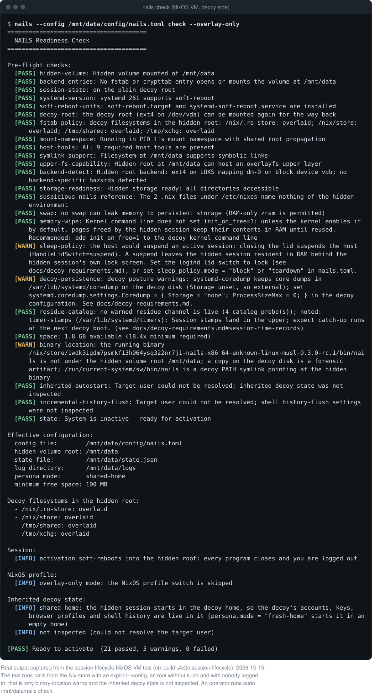
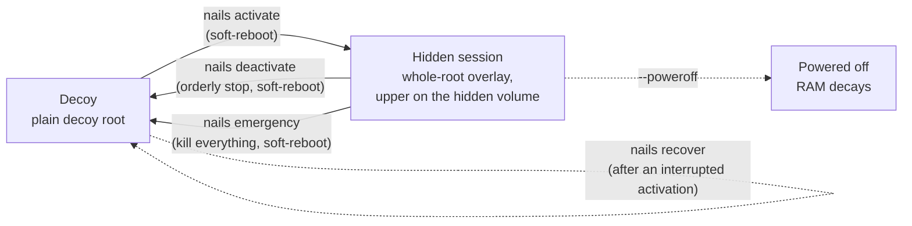
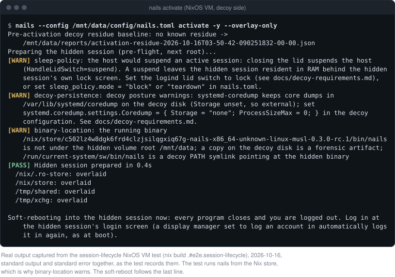
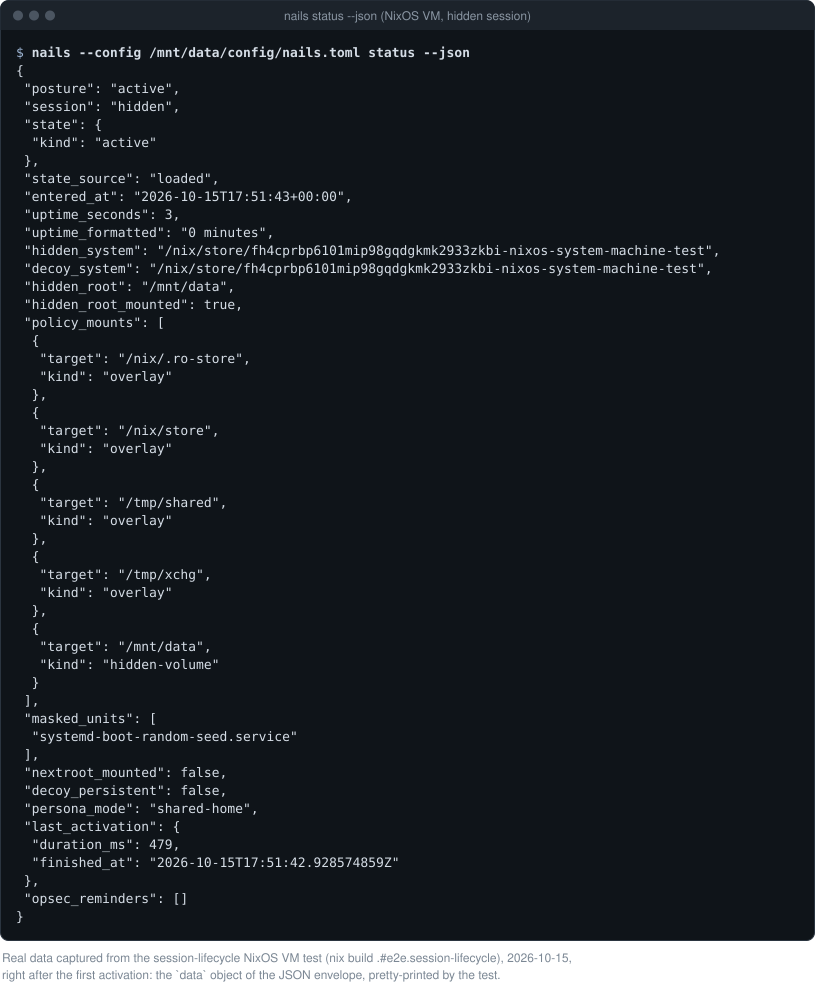
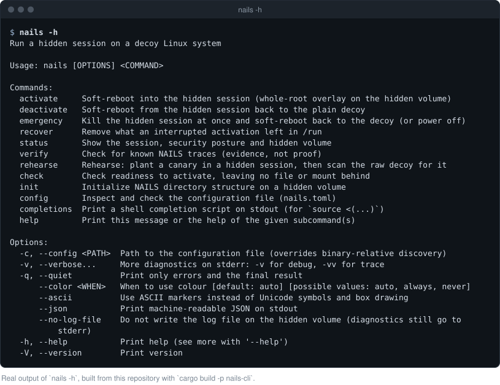

<div align="center">

<picture>
  <source media="(prefers-color-scheme: dark)" srcset="docs/assets/banner-dark.svg">
  
</picture>

[](https://github.com/WitteShadovv/nails/actions/workflows/ci.yml)
[](https://github.com/WitteShadovv/nails/actions/workflows/e2e.yml)
[](https://github.com/WitteShadovv/nails/actions/workflows/distro-e2e.yml)
[](https://github.com/WitteShadovv/nails/releases)
[](https://scorecard.dev/viewer/?uri=github.com/WitteShadovv/nails)
<br>
[](LICENSE)
[](rust-toolchain.toml)
[](#requirements)
[](#requirements)
[](#project-status)

</div>

NAILS is a command-line tool that runs a hidden session on an ordinary-looking
("decoy") Linux system. It soft-reboots the machine into one OverlayFS overlay
over the whole decoy root, with every change written to an encrypted hidden
volume you provide, and soft-reboots back to the plain decoy when you are done.
Nothing that starts the hidden session is installed on the decoy.

Website and documentation: [nails.run](https://nails.run)

NixOS is the first-class platform (a declarative hidden configuration is built
and entered in the same step); Debian 13, Ubuntu 24.04 and Ubuntu 26.04 run the
same session with whatever the hidden `/etc` holds.

> [!WARNING]
> NAILS is **alpha** security software. It is meant for technically experienced
> users who can test their exact machine, storage backend and procedure before
> relying on it. It narrows what a forensic examination of the decoy can find; it
> does not make you invisible. Read the [operator guide](docs/operator-guide.md)
> and the [threat model](docs/threat-model.md) first.

**Contents:** [Threat model in brief](#threat-model-in-brief) ·
[Requirements](#requirements) · [Installation](#installation) ·
[Quick start](#quick-start) · [The session lifecycle](#the-session-lifecycle) ·
[Safety notes](#safety-notes) · [Commands](#commands) ·
[Documentation](#documentation) · [Development](#development)

## What NAILS does

There are two environments on one machine:

- the **decoy**: the installed system, which should stay mundane and plausible;
- the **hidden session**: the same system started again on an overlay whose
  writable layer lives on a hidden volume that you unlock and mount yourself
  (for example a VeraCrypt hidden volume or a LUKS2 volume).

`nails activate` builds the overlay at `/run/nextroot` and enters it with
`systemctl soft-reboot`: systemd stops every decoy program, switches root into the
overlay and starts a fresh userspace there. Every process of the hidden session,
from the desktop to the services, starts inside the overlay, so whatever it
writes through the decoy's mounted filesystems lands in the upper on the hidden
volume. The few writes that go around the mount layer (a disk the session mounts
itself, EFI variables) are listed under
[residual channels](docs/threat-model.md#residual-channels).
`nails deactivate` soft-reboots back into the plain decoy root and closes the
hidden volume on the way. `nails emergency` does the
same at once, or powers the machine off.

NAILS does **not** encrypt anything itself. The hidden volume, and its
deniability, come from the storage backend you choose; see
[docs/backends.md](docs/backends.md).

The [architecture overview](docs/architecture.md#why-one-overlay-over-the-whole-root)
explains why the session takes the whole root and what that costs.

## Non-goals

NAILS keeps a small, fixed feature set and adds to it only with a reason. It
deliberately does not, and will not, provide:

- autologin of any kind;
- a text-mode (TUI) interface, or remote control;
- more than one hidden session or privilege level;
- a duress password, or any wipe-on-duress mechanism;
- support for phones, or for cloud servers;
- an in-app updater;
- a settings editor, autostart, or notifications on the decoy;
- a tray icon;
- an inactivity trigger that ends a session on its own;
- configuration presets;
- telemetry of any kind.

Several of these are safety choices, not missing conveniences: a duress
password, an autologin or an inactivity trigger would each add a secret, or a
way for a session to end, that a person under stress could not reason about.

## Threat model in brief

NAILS is built for one adversary: someone who gets **offline access to the
disks** after the fact, typically by seizing a powered-off machine, and may make
you unlock the **decoy** once. After a clean session on a correctly prepared
decoy, the decoy disk holds nothing of the hidden session except a short, documented
list of residual channels, and no hook that would start it.

What it helps with:

- keeping the hidden session's files, logs, shell history and package builds off
  the decoy disk (they all land in the overlay's upper on the hidden volume);
- leaving no enabler on the decoy: no boot entry, initrd change, unit or binary;
- checking your own setup: `nails check` before entry, `nails verify` for known
  artifacts, and `nails rehearse` to plant a canary and search the raw decoy disk
  for it.

What it does **not** protect against:

- anyone with access to the **running** machine, memory forensics, or cold-boot
  attacks (power off after a session: a soft-reboot keeps RAM);
- **network and remote records**: the hidden session shares the decoy's kernel,
  machine-id, hostname, MAC addresses and, by default, its user account and
  home; ISPs, VPNs and online services see whatever it does;
- compelled disclosure of the **hidden** volume, physical or repeated coercion,
  or an adversary who images the disk more than once and compares;
- a persistent decoy: a journal, syslog or audit log on the decoy disk records
  the soft-reboots. Activation refuses such a decoy unless you override it;
- firmware or hardware compromise, keyloggers, side channels, or a compromised
  root on the decoy.

The full adversary, assumptions, residual channels and evaluation scope are in
[docs/threat-model.md](docs/threat-model.md). It is the only place the threat
model is written down; read it before relying on NAILS.

## Requirements

| Requirement | Notes |
|---|---|
| A supported host | NixOS, Debian 13, or Ubuntu 24.04 or 26.04, with **systemd 254 or newer**. A later Debian or Ubuntu release runs with a warning that NAILS has not been tested on it; other hosts are refused (see below). |
| An amnesic decoy | The decoy must keep no durable record of the session: volatile journald, no rsyslog, syslog-ng or auditd, no disk swap. Activation fails closed otherwise; `--allow-persistent-decoy` overrides the journal, syslog and audit refusals for one run, never the swap check. See [docs/decoy-requirements.md](docs/decoy-requirements.md). |
| A decoy root on a block device | ext4, xfs, btrfs or f2fs. The way back mounts the decoy root again by its device. |
| A hidden volume | Storage of its own: not a folder, a subvolume or a bind mount of a filesystem the computer uses, nor a volume inside its storage. Mounted, writable and kernel-managed (dm-crypt, a loop device), with a filesystem that can host an overlayfs upper: ext4, xfs, btrfs or f2fs. See [docs/backends.md](docs/backends.md). |
| Root (`sudo`) | `activate`, `deactivate`, `emergency`, `recover` and the writing `rehearse` steps refuse to run without it. Run `init`, `check`, `status`, `verify`, `config` and `discard` with `sudo` too, as the examples do, so they can read and write root-owned files: the configuration `init` writes is readable by root only. |
| A local account | The account you run `sudo` from must be in `/etc/passwd`: the static binary does not use NSS, so LDAP or SSSD accounts cannot be resolved. |

<details>
<summary><b>Platform matrix and refused setups</b></summary>

NAILS detects the host from `/etc/os-release` and the running init and names it
in the `platform` row of `nails check`; the pre-flight checks then confirm it can
soft-reboot.

| Platform | Support | Notes |
|---|---|---|
| NixOS | Full | A hidden NixOS configuration (flake or `configuration.nix`) is built into the hidden root's store and entered in the same soft-reboot. It must run on the decoy's kernel. Pinned nixpkgs without `soft-reboot.target`/`systemd-soft-reboot.service` need a small module, which `nails check` prints. |
| Debian 13 (trixie) | Root overlay | The same whole-root session; the hidden configuration is whatever the upper's `/etc` holds. Requires the merged-`/usr` layout. |
| Ubuntu 24.04 and 26.04 | Root overlay | As Debian. On 26.04, chrony and CUPS fail in the hidden session and the decoy shows chrony failed until a full reboot; see [the Ubuntu notes](docs/decoy-requirements.md#ubuntu). |
| Other releases: Debian after 13, Ubuntu after 24.04 | Untested | Accepted on the same terms, with a warning in `init`, `check` and `activate` that NAILS has not been tested on the release, such as Ubuntu 25.04 or 26.10. |
| Debian-family derivatives | Provisional | A host whose `ID_LIKE` names `debian` or `ubuntu` is accepted on the same terms when its systemd is new enough; its base release is not version-gated. |
| Debian 12, Ubuntu 22.04 | Refused | systemd is too old for a soft-reboot (252 and 249). |
| Fedora, Arch, other distributions | Refused | No validated backend yet. Planned; see [ROADMAP.md](ROADMAP.md). |
| ostree and image-based hosts | Refused | NAILS cannot overlay an immutable system. |
| Non-systemd hosts (OpenRC, runit, ...) | Refused | The session is entered and left with a systemd soft-reboot. |

Also refused by the pre-flight checks:

- a decoy root on tmpfs (an impermanent root), ZFS or an overlay (`decoy-root`);
- active disk swap; only RAM-backed zram is allowed (`swap`);
- a persistent journal or an active syslog or audit daemon, unless overridden
  (`decoy-persistence`);
- a hidden volume that is not storage of its own: a folder, a btrfs subvolume
  or bind mount of a filesystem the decoy uses, a volume stacked on the
  decoy's storage, an image file on a decoy filesystem, a filesystem that shows
  no disk it stores its data on (an overlay, FUSE, a network filesystem), or a
  root with a second filesystem mounted over it. The attach gate refuses these
  before anything is written; `--allow-decoy-storage`
  turns the refusal of the decoy's storage into a warning, and never covers a
  folder, a covered root or storage that cannot be judged (`hidden-volume`);
- a decoy `/etc/crypttab` or `/etc/fstab` line that opens or mounts the hidden
  volume (`backend-entries`);
- a hidden volume whose filesystem cannot host an overlayfs upper: NFS,
  CIFS/SMB, 9p, most FUSE mounts, FAT, exFAT and NTFS (`upper-fs-capability`);
- running inside a container or another mount namespace than PID 1's
  (`mount-namespace`).

`nails check` runs every check, changes nothing and prints what it would do.
For the strongest posture, keep state such as `/var` and `/home` on storage that
is wiped at boot (impermanence-style); the decoy *root* itself must stay on a
disk. See
[docs/decoy-requirements.md](docs/decoy-requirements.md).

</details>

## Installation

NAILS is installed by copying a verified static binary onto the mounted hidden
volume, and in no other way. No package, registry or decoy-side install is
supported; [docs/distribution.md](docs/distribution.md) explains why.

1. Outside the decoy system (a live environment that keeps nothing, such as
   [Tails](docs/install-from-tails.md), or a separate machine), download the
   latest bundle from
   [GitHub Releases](https://github.com/WitteShadovv/nails/releases) and verify
   it as [docs/verify-release.md](docs/verify-release.md) describes (checksum
   and build provenance). For more assurance, rebuild it:
   [docs/release-artifact-reproducibility.md](docs/release-artifact-reproducibility.md).
2. Unlock and mount the hidden volume, then put the binary directly on it. Never
   leave a copy on the decoy disk:

   ```bash
   sudo cryptsetup open --type tcrypt --veracrypt --tcrypt-hidden \
     "$HOME/Downloads/family_photos" data
   sudo mount /dev/mapper/data /mnt/data
   sudo install -m0755 /path/to/verified/nails /mnt/data/nails
   ```

The examples use the mapping name `data` and the mount point `/mnt/data`. Keep
yours neutral too: names surface in `/dev/mapper`, `/dev/disk/by-label`, mount
unit names and the journal, and NAILS warns when one contains a telling word.

<details>
<summary><b>Upgrading the binary</b></summary>

New releases appear in the
[releases feed](https://github.com/WitteShadovv/nails/releases.atom), which any
feed reader can follow without a GitHub account. Follow it inside a hidden
session or on another device, never on the decoy.

Replace the binary only while no session is active, as the
[operator guide](docs/operator-guide.md#updating-nails) says. Fetch or build the
new one inside a hidden session, so the downloads and build caches (`~/.cargo`,
`/nix/store`, the `result` GC root) land on the hidden upper and never on the
decoy, and leave it next to the old one on the hidden volume:

```bash
# Inside a hidden session: a verified release (see docs/verify-release.md) ...
sudo install -m0755 /path/to/verified/nails /mnt/data/nails.new

# ... or a build from source
git clone https://github.com/WitteShadovv/nails /mnt/data/src/nails
cd /mnt/data/src/nails
cargo build --release          # or: nix build .#nails (then use ./result/bin/nails)
sudo install -m0755 ./target/release/nails /mnt/data/nails.new
```

Then end the session. The next time you have mounted the hidden volume on the
decoy, and before you activate, put the new binary in place:

```bash
sudo mv /mnt/data/nails.new /mnt/data/nails
```

Never build or download on the decoy: before a session there is no hidden upper
to catch the caches.

Zero-config path discovery trusts the binary installed on the hidden volume. If
you run NAILS from a build directory or `/nix/store`, set `hidden_volume_root`
explicitly or pass `--config`.

</details>

## Quick start

The shortest runnable path. The [operator guide](docs/operator-guide.md) walks the
same steps in full, organised by where each one runs, with a recovery runbook.
Type the decoy-side commands in a shell with history off (`set +o history`).

1. **Mount the hidden volume** (see [Installation](#installation)).
   [docs/backends.md](docs/backends.md) has the commands for a whole-device
   VeraCrypt volume and for LUKS2. Never add cryptsetup's `--allow-discards`.

2. **Lay out the hidden volume** once:

   ```bash
   sudo /mnt/data/nails init /mnt/data
   ```

   `init` refuses a directory that is not a volume of its own (a folder, or a
   subvolume, bind mount or image file on the computer's own storage) before it
   writes or probes anything, so the layout never lands on the decoy disk; see
   [Where setup happens](docs/operator-guide.md#where-setup-happens). On NixOS
   it seeds the hidden NixOS layout from
   `/etc/nixos/hardware-configuration.nix`. It ends by printing the next steps.

3. **Optionally review the configuration**, but not on the decoy: an editor
   leaves its own traces there (swap and backup files, `~/.viminfo`, recent-file
   lists). Every key is optional, and the template `init` writes uses the
   defaults. Prepare `config/nails.toml` on the separate machine, before you copy
   it to the hidden volume (`init` keeps a file that is already there), or inside
   a hidden session as a new file that you move into place after the session, as
   for a [binary update](docs/operator-guide.md#updating-nails):

   ```bash
   # inside a hidden session; the configuration directory is root's
   sudoedit /mnt/data/config/nails.toml.new
   sudo /mnt/data/nails config validate /mnt/data/config/nails.toml.new
   sudo /mnt/data/nails --config /mnt/data/config/nails.toml.new config show   # effective values and their sources
   ```

   Leave `hidden_volume_root` unset to derive it from the binary's location. On
   NixOS, change the hidden module `/mnt/data/config/nixos/configuration.nix`
   inside a hidden session (see the operator guide's
   [Changing the hidden configuration](docs/operator-guide.md#changing-the-hidden-configuration)),
   or build the hidden system from a flake that imports that module. Activation
   finds one in `/mnt/data/nixos` by itself, and a decoy whose `/etc/nixos` is a
   flake needs one: write and lock it inside a hidden session, which
   `activate --overlay-only` enters, never on the decoy, and keep it
   self-contained (see the operator guide's
   [How it works](docs/operator-guide.md#how-it-works)). `nixos_flake` names
   another flake or attribute:

   ```toml
   nixos_flake = "/mnt/data/nixos#my-host"
   ```

   [docs/configuration.md](docs/configuration.md) lists every key.

4. **Check, then activate:**

   ```bash
   sudo /mnt/data/nails check
   sudo /mnt/data/nails activate
   ```

   `check` runs the same pre-flight checks as `activate` and changes nothing.
   `activate` asks for confirmation, prepares the hidden root and soft-reboots:
   **every program closes and you are logged out.** Log in again at the hidden
   session's login screen. NAILS logs nobody in, but a display manager set to
   log an account in automatically logs it in again, as at boot; the
   operator guide says how to
   [turn that off for the hidden session alone](docs/operator-guide.md#inherited-autostart-services-and-autologin).

5. **Verify, then return** from inside the hidden session:

   ```bash
   sudo /mnt/data/nails verify --deep
   sudo /mnt/data/nails deactivate --poweroff
   ```

   `deactivate` without `--poweroff` returns to the decoy's login screen (or,
   with display-manager autologin, to its desktop).
   Powering off is what clears RAM; leave the machine off for a few minutes
   before handing it over.

<details>
<summary><b>What <code>nails check</code> prints</b></summary>



Captured from the `session-readme-captures` NixOS VM test, on a decoy set up as
[docs/decoy-requirements.md](docs/decoy-requirements.md) recommends; see
[docs/assets/README.md](docs/assets/README.md) for how each screenshot is made.

</details>

## The session lifecycle



| Step | Runs on | What happens | What you see |
|---|---|---|---|
| `activate` | the decoy | Pre-flight checks, a read-only residue baseline of the decoy (report on the hidden volume), the root overlay at `/run/nextroot`, on NixOS the hidden system built into the overlay, then the soft-reboot. Ctrl+C before the switch rolls everything back. | Progress and a summary, then your terminal closes and the screen shows a text console for a few seconds. The hidden session starts at its own login screen; a display manager set to log an account in automatically logs it in again. |
| `deactivate` | the hidden session | Mounts the decoy root for the way back, marks the hidden volume for closing, and soft-reboots. The orderly shutdown stops every hidden program; the last step scrubs the top of `/run` of what the session added and deletes the runtime journal, which the decoy shares with it. Network links and addresses the session set up stay. | Programs close as at a logout. The decoy starts at its own login screen; a display manager set to log an account in automatically logs it in again. The hidden volume is unmounted and closed. |
| `emergency` | the hidden session | The same way back, but every hidden program is killed at once (`cgroup.kill`). It acts immediately; `--countdown` adds an abortable wait. If the way back cannot be prepared, it powers off. | A few seconds of text console, then the decoy's normal login screen: log in with the decoy password. NAILS logs nobody in; a display manager set to log an account in automatically logs it in again, as at boot. |
| `--poweroff` | either command | Powers off instead of returning to the decoy. | The machine turns off. |
| `recover` | the decoy | Removes what an interrupted activation left in `/run` and resets the state. Never reboots. | A short report. |

Both transitions log you out. Save your work first.



<details>
<summary><b>What <code>nails status --json</code> reports in the hidden session</b></summary>



`place` says where the machine is (`decoy`, `hidden` or `activating`), and
`attention` names the one thing that needs you, such as `interrupted` or
`no_way_back`, or is `null`. The object is the `data` of a one-line versioned
envelope (`schema_version` 2); [Commands](#commands) describes the envelope and
the exit codes, and [docs/schemas/](docs/schemas/) has a schema per command.

</details>

## Safety notes

- **NAILS does not mount, unlock or protect the hidden volume.** That is your
  backend's job, and so is its deniability.
- **Run it by its full path on the hidden volume** (`sudo /mnt/data/nails ...`).
  Never put a copy, symlink or `PATH` entry on the decoy: the binary holds
  identifiable strings that survive deletion.
- **The hidden volume must stay mounted for the whole session.** It is
  kernel-managed for that reason: a FUSE mount dies with the programs at the
  soft-reboot.
- **A soft-reboot leaves traces in RAM**: the kernel ring buffer, the
  soft-reboot counter (two per session, on systemd 256 and newer) and the
  unchanged boot ID and uptime.
  Power off after a session when that matters. A warm reboot does not clear RAM
  either.
- **The way back keeps the session's network state**: the links, addresses,
  routes and VPN tunnels it set up stay up in the decoy, and the decoy's
  NetworkManager records a link it adopts on the decoy disk as soon as the
  decoy starts. Take down what you brought up and delete the links you created
  before you deactivate, or end with `deactivate --poweroff`. See the
  [operator guide](docs/operator-guide.md#how-it-works).
- **Do not suspend during a session.** Suspend keeps the whole hidden session
  and the volume key in RAM. Set the lid switch to `lock` and
  consider `sleep_policy` (see [docs/configuration.md](docs/configuration.md#sleep-policy)).
- **Do not start the decoy's sync and account clients** in the hidden session
  for sensitive work: what they send stays on the remote side, and a decoy client
  can pull it back after the session. See the
  [operator guide](docs/operator-guide.md#remote-state-and-sync-clients).
- **A clean `nails verify` is evidence, not proof.** It checks for known
  artifacts and lists what it did not check.
- **Panic button:** bind a key to a root-owned unit that runs
  `nails emergency --poweroff`, defined only in the hidden configuration. Never
  give the binary a passwordless `sudo` rule. See the
  [operator guide](docs/operator-guide.md#panic-switch).

<details>
<summary><b>Hidden-volume space, copy-up and shadowed decoy updates</b></summary>

The hidden root's upper persists across sessions. OverlayFS copies a decoy file
into the upper **in full** the first time it is written, truncated or
re-chmod/chowned, so the first write to a large file (the Nix database, a browser
profile, a VM image) can stall on a slow or encrypted backend, and the upper only
grows. On NixOS the first entry also copies the hidden system's whole closure
onto the hidden volume, which can take several GB and minutes. A file copied up
earlier also **shadows** later decoy updates of that file: after a decoy package
upgrade or rebuild, the hidden session still sees its own older copy.

- watch free space with `df -h /mnt/data`; `nails check` fails when it drops
  below `minimum_space_mb`;
- run `nix-collect-garbage -d` and clear caches **inside** the hidden session;
- from the decoy, `sudo /mnt/data/nails discard <PATH>` deletes a path's
  hidden copy so the decoy's own files show through again (it asks first, and is
  refused in the hidden session).

See [the operator guide](docs/operator-guide.md#copy-up-cost-and-shadowed-decoy-updates).

</details>

<details>
<summary><b>Troubleshooting</b></summary>

In the hidden session the way out is always `deactivate`, then `emergency`, then a
power-off. A power-off is always safe: nothing of the session is installed on the
decoy and everything NAILS puts in `/run` is gone at power-off.

| Situation | What to do |
|---|---|
| `nails check` fails | Read the `->` hint under each failing check; it names the fix. |
| Activation was interrupted (killed, crashed) | `nails status` exits 7 and says to run `nails recover`. Run it on the decoy. Ctrl+C during activation rolls back by itself. |
| `deactivate` refuses or fails | Run `nails emergency`. |
| The hidden session hangs | Switch to a text console (Ctrl+Alt+F2), log in and run `nails emergency`. A stuck service can delay `deactivate` by up to 90 s; `emergency` does not wait. |
| The hidden volume failed (USB pulled, I/O errors) | Run the RAM copy activation left behind: `sudo /run/overlay-runtime/control emergency`. Power off if that does not respond. |
| The hidden volume is full | Free space inside the session, or deactivate and `discard` a large path from the decoy. Never delete files out of the upper by hand. |
| Power loss or crash | The decoy boots normally. If `nails status` reports a mismatched state, run `nails recover` once. |

The full runbook, including cleaning up by hand when `recover` cannot run, is in
[the operator guide](docs/operator-guide.md#when-things-go-wrong).

</details>

<details>
<summary><b>FAQ</b></summary>

**Does NAILS hide that a hidden volume exists?** No. That depends on the backend:
VeraCrypt's own claim is conditional — it should be impossible to prove a hidden
volume exists *if* VeraCrypt's requirements are followed, and its documentation
notes that multiple disk snapshots over time, wear-levelling or TRIM can still
betray one — while a LUKS volume is visibly an encrypted volume. NAILS adds
nothing to the backend's claim. It keeps the *session* off the decoy.

**Can I keep working on the decoy while the hidden session runs?** No. Only one
of them runs at a time; switching logs you out of the other.

**Why does it need a soft-reboot?** Every process of the hidden session then
starts inside the overlay, so there is nothing on the decoy side to find,
restart or kill. The older design that overlaid a running system directory by
directory could miss a writer silently; see
[the architecture overview](docs/architecture.md#why-one-overlay-over-the-whole-root).

**Does the hidden session get its own account?** Not yet. By default it runs as
the decoy user in the decoy home seen through the overlay; the `fresh-home`
persona gives it an empty home instead. See
[persona modes](docs/configuration.md#persona-modes).

**Does it work on a persistent decoy?** Only with `--allow-persistent-decoy`,
and then the decoy's journal records the soft-reboots and the activation
command. Prefer an amnesic decoy.

**How do I know it works on my machine?** Run `nails rehearse` (plant a canary in
a hidden session, then search the raw decoy disk for it) and
`nails verify --offline --examiner` against an image of the decoy. See
[the operator guide](docs/operator-guide.md#rehearsing-before-you-rely-on-it).

</details>

## Commands

The binary lives on the hidden volume, so every invocation uses its full path.
`sudo`'s `secure_path` does not include the hidden volume, so a bare
`sudo nails` would not resolve.

| Command | Where | Purpose |
|---|---|---|
| `init <PATH>` | decoy | Lay out a mounted hidden volume |
| `check` | decoy | Report readiness to activate, changing nothing |
| `activate` | decoy | Soft-reboot into the hidden session |
| `deactivate` | hidden session | Soft-reboot back to the plain decoy (`--poweroff` to power off) |
| `emergency` | either | Kill the hidden session at once and return (or power off); on the decoy, remove an interrupted activation |
| `recover` | decoy | Remove what an interrupted activation left in `/run` |
| `status` | either | The live session, security posture and hidden-volume space |
| `verify` | hidden session | Scan for known artifacts (live, or `--offline` against a decoy image) |
| `rehearse` | both | Plant a canary in a hidden session, then scan the raw decoy disk for it |
| `discard <PATH>` | decoy | Delete a path's hidden copy from the hidden root's upper |
| `config path\|show\|validate` | either | Locate, inspect or check the configuration file |
| `completions <SHELL>` | either | Print a shell completion script |

The full reference, generated from the code, is [docs/cli.md](docs/cli.md) (also
shipped as the `nails.1` man page).

<details>
<summary><b><code>nails -h</code></b></summary>



</details>

<details>
<summary><b>Exit codes and JSON output</b></summary>

Every command returns one of these codes; scripts can rely on them.

| Code | Meaning |
|---|---|
| `0` | Success |
| `1` | The operation failed |
| `2` | Command-line usage error |
| `3` | The configuration file or environment was unusable |
| `4` | A pre-flight check refused the operation |
| `5` | The operation needs privileges it did not have |
| `6` | The on-disk state could not be trusted |
| `7` | A degraded or interrupted session, or an incomplete cleanup; `nails status` names the fix (usually `nails recover`) |
| `8` | The host is not one NAILS can operate on |
| `9` | Completed, but with a warning the caller should act on |
| `10` | `verify` found warnings |
| `11` | `verify` found critical artifacts, or `rehearse scan` found its canary |
| `130` | Cancelled: a declined prompt, or a signal (SIGINT/SIGTERM); an entry in progress is rolled back |

With `--json`, every command but `completions` writes exactly one line on
stdout, `activate` included: a stable envelope with `schema_version` (currently
`2`), the `command` name, an `ok` boolean that is `true` only for exit `0` or
`9`, and a typed `data` object, an `error` object, or both (a failed `activate`
still reports its data). An `error` has a snake_case `code`, a `message` that
may run to several lines, and `next`: the command to run next, without the
binary's path (`{"command": "recover"}`), or `null`. A cancel, whether a "no"
at a prompt or an activation stopped with Ctrl+C, reports the error `cancelled`
(with no `data`) and exits `130`. Each command's schema is in
[docs/schemas/](docs/schemas/). A new schema version signals an incompatible
change.

</details>

<details>
<summary><b>Upgrading from an earlier release</b></summary>

Upgrade only while NAILS is inactive: end a 0.2 session with its own
`nails deactivate` (a reboot ends it too) before replacing the binary. This
release changes operator-facing interfaces, with no compatibility shim: convert
your setup before running the new binary.

- **Session mode.** The per-directory overlays (`/etc`, `/home`, `/var`, ...) are
  gone. The only mode is the whole-root session entered and left with a
  soft-reboot, which needs systemd 254 or newer. Besides NixOS, Debian 13,
  Ubuntu 24.04 and Ubuntu 26.04 are now supported as decoys, and a later Debian
  or Ubuntu release runs with a warning. The hidden root's layers
  live under `<hidden-root>/root/` (among them `upper`, `work` and `mounts`);
  the uppers of the old mode (`<hidden-root>/<name>` and
  `<hidden-root>/.work`) are not read. Move what you need from them into the
  hidden session, then delete them. On NixOS the hidden hardware configuration
  moves to `<hidden-root>/root/upper/etc/nixos/`; run `nails init` again to
  place it.
- **NixOS flake decoys.** A decoy whose `/etc/nixos` is a flake needs a hidden
  flake: activation refuses to build the decoy's own flake, also when
  `nixos_flake` or `--nixos-flake` names it
  (`/etc/nixos#host`, the form 0.2's examples used, `path:/etc/nixos`,
  `git+file:///etc/nixos`, `path:/etc?dir=nixos` or a link to it) and when
  `<hidden-root>/nixos` is a link to it, because it would leave out the hidden
  module and the hidden hardware configuration. Write a self-contained flake
  in `<hidden-root>/nixos` that imports the hidden module
  (`<hidden-root>/config/nixos/configuration.nix`) and reads none of the
  decoy's files, write and lock it inside a hidden session
  (`activate --overlay-only` enters one), never on the decoy, and build it
  there with `nixos-rebuild build --flake <hidden-root>/nixos#<host> --impure`,
  `<host>` being the decoy's hostname; `nixos_flake` names such a flake
  elsewhere (see [How it works](docs/operator-guide.md#how-it-works) in the
  operator guide).
- **A volume of its own.** The hidden root must be a volume of its own. NAILS
  now refuses a root that 0.2 accepted: a folder (no mount point), a btrfs
  subvolume or bind of a folder of a filesystem the decoy uses, a logical volume
  in the decoy's volume group, an image file on a decoy filesystem, and an
  overlay, FUSE, network or ZFS filesystem. Move the hidden volume to a device
  of its own (see
  [Where setup happens](docs/operator-guide.md#where-setup-happens) in the
  operator guide). An unprivileged `check` or `status` on a distribution whose
  `/etc/crypttab` only root can read gets `storage_unjudged` and logs to stderr
  only; run it with `sudo`.
- **Configuration format.** Configuration is strict TOML, in
  `config/nails.toml` next to the binary on the hidden volume. The new binary
  never reads the YAML file of 0.2 and does not warn about it: an unconverted
  setup runs with the defaults. Convert each key by hand (see
  [docs/configuration.md](docs/configuration.md)); the hidden volume's key is
  now `hidden_volume_root`, which you can leave unset to derive it from the
  binary's location. Unknown keys, wrong types and syntax errors are rejected
  with a one-line message, and so are the keys 0.3 dropped, those of the
  per-directory overlay mode among them; the changelog's "Removed" section
  lists every one.
  `nails init` writes a documented template, and
  `nails config show --example` prints every key.
- **Invocation.** Always run the binary by its full path on the hidden volume.
  No copy, symlink or `PATH` entry on the decoy is supported.
- **Flags and commands.** The output flags are global and accepted in any
  position, and the old per-command output flags are replaced by `--color`,
  `--ascii`, `--quiet`, `--verbose` and `--no-log-file`. `activate --flake` is
  now `--nixos-flake`, and `status -v` is now `status --details`. The flags of
  the live-overlay mode (the history, session, pivot and prompt options of
  `activate` and `deactivate`, and the countdown switch of `emergency`) and its
  notification command are removed; the changelog's "Removed" section names
  each of them.
- **Confirmation.** `activate` and `deactivate` now ask for confirmation, and
  without a terminal they refuse with exit 2 (`needs_confirmation`); 0.2
  skipped the prompt unless `--interactive` was given. Add `-y` to every
  script, keybinding or unit that runs them; `emergency` never prompts.
- **Exit codes and JSON.** The process returns the documented exit codes, and
  `--json` prints one versioned envelope per command (`schema_version = 2`).
  Scripts written for version 1, which the 0.3.0 release candidates printed,
  must be updated: `status` reports `place` and `attention` instead of
  `posture`, `session`, `state` and `state_source`; an error carries a typed
  `next` instead of `hint`; `ok` is `true` only for exit 0 or 9; and a "no"
  at a prompt exits 130 instead of 1. `activate` prints one envelope instead
  of a progress line and a result line: the fields of that result line other
  than `schema_version`, `command`, `ok` and `type` (`status`, `duration`,
  `filesystems`, `masked_units`, `message` and the rest) are now under
  `data`, and `type` is gone. A failure that version 1 gave the `status`
  `error` now carries an `error`, whose `code` names the cause (`not_ready`
  for a refused pre-flight check), and `data` with the `status` `failed`; a
  cancel, which version 1 gave the `status` `cancelled`, is the error
  `cancelled` with no `data`.
- **State schema.** `state.json` carries a `version` field. The states are
  `Inactive`, `Active` and `Degraded`; `nails status` reads the live session from
  the mount table and the session plan in `/run`, because a soft-reboot keeps the
  boot ID. The new binary cannot verify a state file that 0.2 wrote: `status`
  reports the state as unknown and `activate` refuses (exit 6) until you delete
  the file, from a clean inactive system; do not hand-edit it.

The release changelog mirrors these notes under its "Upgrade notes" heading; keep
[CHANGELOG.md](CHANGELOG.md) and this section in step when cutting a release.

</details>

## Documentation

The full index is [docs/README.md](docs/README.md). The essentials:

- [Operator guide](docs/operator-guide.md): the whole workflow by where each step
  runs, the recovery runbook and the honest limits
- [Threat model](docs/threat-model.md): adversary, assumptions, residual channels
- [Decoy requirements](docs/decoy-requirements.md): what the decoy must and must
  not keep, per platform
- [Storage backends](docs/backends.md): which backends work and the hazards of each
- [Configuration](docs/configuration.md) and [CLI](docs/cli.md) reference
- [Verify a release](docs/verify-release.md)
- [Architecture](docs/architecture.md): why the session takes the whole root,
  the crates and the runtime layers
- [Project site](https://nails.run), [changelog](CHANGELOG.md),
  [roadmap](ROADMAP.md)

## Development

NAILS is a Cargo workspace of seven crates (the `nails` binary and six
libraries); [docs/architecture.md](docs/architecture.md) shows how they fit
together.

<details>
<summary><b>Developer quick start</b></summary>

```bash
git clone https://github.com/WitteShadovv/nails.git
cd nails
nix develop          # the pinned toolchain and every tool the checks use
just check           # formatting, clippy, file sizes and the tests
nix flake check      # Nix, shell and workflow linters (no VM tests)
nix build .#e2e.session-lifecycle --no-link -L   # one NixOS VM test (needs KVM)
```

- [CONTRIBUTING.md](CONTRIBUTING.md): setup, conventions, sign-off
- [Development guide](docs/development-guide.md) and
  [testing strategy](docs/testing-strategy.md)
- [VM test suite](nix/e2e-tests/README.md) and [CI](docs/ci.md)
- [Releasing](RELEASING.md)

</details>

## Related projects

- **NAILS** (this repository) is the CLI and workflow for running a hidden session
  over an existing decoy system you operate.
- **[NAILS OS](https://github.com/WitteShadovv/nails-os)** is a separate
  installable NixOS distribution with its own live ISO, installer, persistence
  model and system-level security design. Its root is a tmpfs, and NAILS needs
  a decoy root on a block device (the `decoy-root` check), so NAILS does not run
  on NAILS OS.

They are related, but not interchangeable, and do not share the same installation
or threat-model boundaries.

## Project status

NAILS is actively maintained and released as **alpha** software.

- Interfaces and operator workflows can still change between alpha releases.
- Use it only after testing your exact hardware, storage backend, activation path
  and recovery procedure.
- Security claims are bounded by the documented threat model and by the checks
  you run on your own setup.
- How releases are produced, numbered and verified: [RELEASING.md](RELEASING.md).

Policies: [contributing](CONTRIBUTING.md) · [security](SECURITY.md) ·
[support](SUPPORT.md) · [code of conduct](CODE_OF_CONDUCT.md) ·
[code owners](CODEOWNERS)

## Acknowledgements

- [Tails](https://tails.net)
- [NixOS](https://nixos.org)
- [Tor Project](https://www.torproject.org)
- [nix-community/impermanence](https://github.com/nix-community/impermanence)

NAILS has been developed with AI-assisted tooling for drafting code, tests, and documentation. All security-relevant design decisions, code changes, and published documentation remain the responsibility of the maintainer and are intended to be reviewed and validated before release.

## License and disclaimer

Copyright (C) 2025-2026 WitteShadovv.

This project is licensed under the **GNU General Public License v3.0 or later**.
See [LICENSE](LICENSE).

The graphical interface in `gui/` is licensed under **GPL-3.0-only** instead: it
may use the GPL-3.0-or-later crates, but no crate outside `gui/` may depend on
it.

> [!CAUTION]
> This software is provided for educational and security research purposes. It
> comes with no warranty, and it should not be treated as a guarantee of
> deniability or forensic invisibility in any specific threat environment.

## Maintainer

Maintained by [WitteShadovv](https://witteshadovv.dev).
