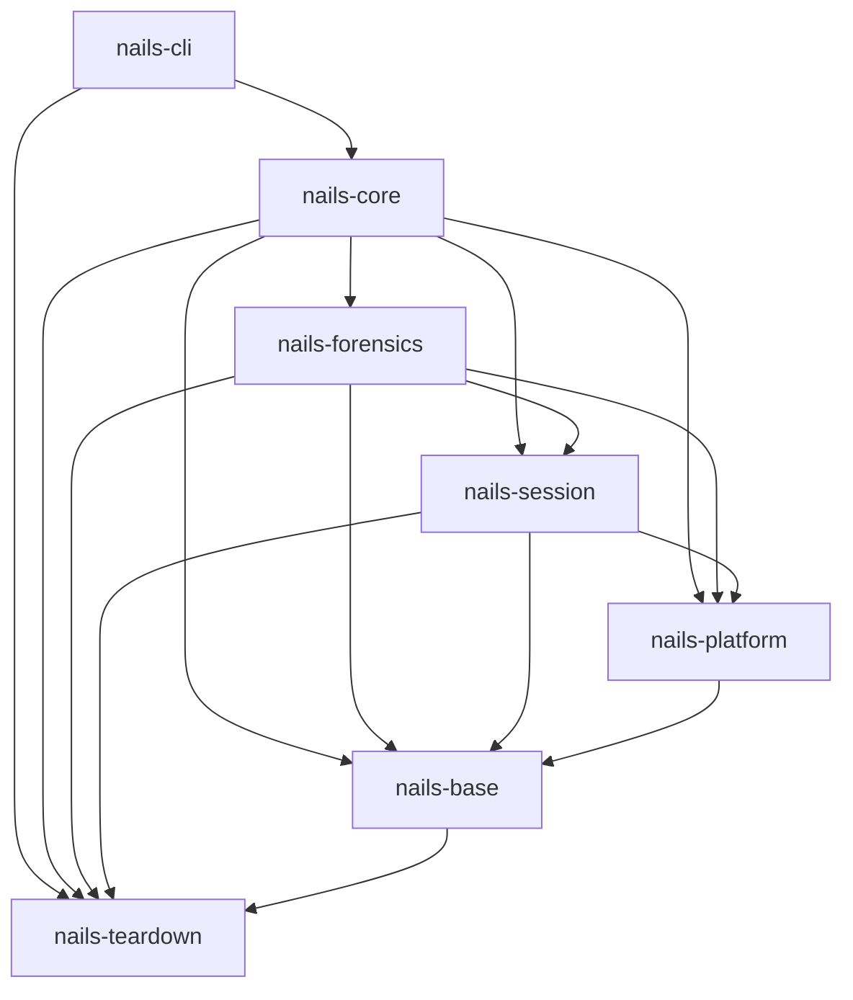

# Architecture overview

This is a map of how NAILS is put together: the crates, the seam that keeps
host-specific behaviour in one place, and the runtime layers an activation runs
through. It is an orientation document, not a specification — the code and the
[architecture decision records](adr/README.md) are authoritative where they
disagree with this page.

## Crates

NAILS is a Cargo workspace with a deliberately thin binary, five library crates
split along the session's boundaries, and a small crate for the emergency hot
path and the soft-reboot transition. Each crate depends only on the crates
below it in this list. The edges between them, as the manifests declare them
and `nails-core/tests/crate_graph.rs` pins them:

`nails-cli` reaches `nails-teardown` directly because `main` runs the emergency
and the transition step before anything else is initialised.

- **`nails-cli`** parses arguments, renders human and JSON output, prompts, and
  turns results into the documented exit codes. It contains no activation logic:
  it builds a request, hands it to the library, and formats what comes back.
- **`nails-core`** ties the areas together: the manager (enter, leave,
  recover, reset-upper), the pre-flight registry and the checks that need
  several areas, and `status`. It re-exports every module of the crates below
  under its own name (`nails_core::config`, `nails_core::verify`, …), so the
  CLI talks to one library.
- **`nails-forensics`** looks for traces and never makes or removes them:
  `verify` (live and offline, the examiner's view, the drift scanners), the
  read-only raw-device and tree readers, the residue catalog and its check, and
  `rehearse`.
- **`nails-session`** is the configuration-aware half of the whole-root
  session: the entry, the fstab policy, the hidden NixOS build, the way back,
  the session's checks and the probes `status` uses, the persona, and the
  session's runtime units (the RAM copy reader, the backend watcher and the
  sleep guard).
- **`nails-platform`** holds everything host-specific: detection, the
  `Platform` backends, the NixOS configuration layer and its checks, the NixOS
  builder and the backend chain resolver.
- **`nails-base`** is the foundation every library crate reads: the error type,
  the `Filesystem` and process seams (with the host-command resolver),
  configuration, state, the artifact registry, the attach gate, logging,
  output, notifications and the pre-flight framework. It also holds the
  `/etc/fstab` and `/etc/crypttab` parsers and the list of words that give
  hidden storage away in a name.
- **`nails-teardown`** holds everything the panic path and the soft-reboot
  transition need, with no configuration and no logging
  (`nails_teardown::whole_root`): the session plan on `/run`, the mount
  primitives and the pre-switch init check, the transition step, the `/run`
  snapshot and scrub, the kmsg cursor, the way back, the runtime units and
  masks, the kill of all userspace and the emergency hot path. It also holds the
  mountinfo parser and the cgroup, pidfd and shell kills. It depends on
  `rustix`, `libc`, `serde` and `serde_json` only, so `main` can run the emergency and the
  transition before clap, the configuration or tracing exist.

Keeping the logic in the library (rather than in the binary) is recorded in
[ADR 0001](adr/0001-core-library-boundary.md), the split into these crates and
the tests that hold their boundaries in
[ADR 0010](adr/0010-library-crate-split.md), and the teardown crate and its
boundary in [ADR 0007](adr/0007-emergency-architecture.md) and
[ADR 0008](adr/0008-whole-root-soft-reboot.md).

## The platform seam

Every host-specific decision is made in one module, `platform` (in
`nails-platform`), so the rest of
the code never branches on "is this NixOS?" directly.

1. **Detection.** `platform::detect` reads `/etc/os-release`,
   `/run/current-system`, `/run/ostree-booted` and PID 1 once, producing a
   `HostProfile`.
2. **Selection.** A single function maps that profile to a backend implementing
   the `Platform` trait:
   - `NixOsPlatform` — the first-class backend, with a declarative config layer
     that builds the hidden system into the next root's store.
   - `FhsPlatform` — the backend for Debian-family hosts: Debian 13 and newer,
     Ubuntu 24.04 and newer, and provisionally derivatives whose `ID_LIKE`
     names `debian` or `ubuntu`. The hidden configuration is whatever the
     upper's `/etc` holds. (A Debian 12 host is detected as FHS and then
     refused by the systemd version check: it cannot soft-reboot.)
   - `UnsupportedPlatform` — refuses every other host with a typed error:
     ostree and image-based hosts, non-systemd init, Fedora, Arch and unknown
     distributions. For those hosts the refusal *is* the behaviour.
3. **Policy.** The trait collects the host-specific decisions: where host tools
   live (`host_command_dirs`) and which declarative build target activation and
   `check` use (`discover_build_target`). `verify` picks its read-only drift
   scanners from the detected platform kind.

The declarative part of a host is expressed through a separate `ConfigLayer`.
NixOS supplies one (`NixOsConfigLayer`), whose hidden system is built into the
next root's store; FHS hosts and any `--overlay-only` run have no layer, so the
build step is skipped and the session enters with the decoy's own system plus
the hidden `/etc`.

Adding a new distribution means adding a `Platform` backend (and, if it is
declarative, a `ConfigLayer`); nothing else in the codebase needs to learn about
it.

## Runtime layers

An activation moves through these layers; each names its modules and crates:

- **Configuration** (`config`, `nails-base`) loads strict TOML (`nails.toml`), layers CLI
  overrides on top, and derives the hidden-volume root from the binary location
  when it is not set. See the [configuration reference](configuration.md).
- **State machine** (`state`, `nails-base`) models the recorded state as a type-safe enum
  (`Inactive`, `Active`, `Degraded`) with only the legal transitions
  expressible, persisted to `state.json`. Because a soft-reboot keeps the boot
  ID, the live session (hidden root, entry under way, interrupted entry, plain
  decoy) is read from the mount table and the session plan
  (`session::probe`), not from the state file. The rationale for the typed
  states is in [ADR 0003](adr/0003-type-safe-state-machine.md).
- **Pre-flight** (the framework in `nails-base`, the registry and most checks
  in `nails-core`, `session::checks` in `nails-session`) runs a registry of
  trait-based checks — systemd version and the soft-reboot units, the decoy
  root, the fstab policy, backend readiness, overlay-filesystem capability,
  space, the amnesic-decoy guard, and more — before anything is mounted, and
  fails closed.
- **Entry** (`session::entry`, `session::policy`, `session::nixos`, in
  `nails-session`) snapshots
  `/run`, writes the session plan and the RAM copy of the binary to
  `/run/overlay-runtime`, mounts the root overlay at `/run/nextroot`, builds
  and activates the hidden NixOS system there, applies the fstab policy, checks
  the init and installs the transition drop-in. Any failure undoes all of it, so
  a populated `/run/nextroot` is never left behind. Path containment and the
  mount APIs are described in [ADR 0004](adr/0004-detached-mount-apis.md); why
  the overlay covers the whole root and is entered with a soft-reboot, rather
  than taken live per directory or at boot, is recorded in
  [ADR 0008](adr/0008-whole-root-soft-reboot.md), which supersedes
  [ADR 0005](adr/0005-live-overlay-vs-boot-time-overlay.md).
- **Transition** (`nails-teardown`, `whole_root::transition`) is the
  `ExecStart=` of `systemd-soft-reboot.service`, run by systemd from the RAM
  copy as the last userspace step before each switch. It acts only on an armed
  plan: entering, it repoints `/run/current-system` (NixOS) and installs the
  session's runtime units and masks; leaving, it repoints back, scrubs `/run`,
  restores `utab` and writes the kmsg cursor. An unarmed populated
  `/run/nextroot` is detached instead.
- **Way back and emergency** (`nails-session`'s `session::leave`, `nails-teardown`'s
  `whole_root::ret` and `whole_root::emergency`) mount the decoy root at
  `/run/nextroot`, mark the backend for deferred removal and enqueue the
  soft-reboot; the emergency kills every hidden cgroup first. Emergency runs
  the hot path from `main` before clap (the design history is in
  [ADR 0007](adr/0007-emergency-architecture.md)).
- **Verification** (`verify`, `nails-forensics`) scans for known residue, live or offline against
  a decoy image.

## Testing without root

Filesystem and process effects are reached through the `Filesystem` and process
traits, with mock implementations used in tests. This lets almost the entire
library be unit-tested without root or a real mount, and is recorded in
[ADR 0002](adr/0002-trait-filesystem-testability.md). End-to-end behaviour that
genuinely needs a booted system — real soft-reboots, the hidden NixOS system,
the fstab policy, forensic residue — is covered by the NixOS VM tests under
`nix/e2e-tests` and the Debian/Ubuntu tier under `nix/distro-tests`. Between
the two, a rootless real-kernel tier (`nails_base::test_support::Rerun`, for
example `nails-core/tests/whole_root_kernel.rs`) runs the session's mount
primitives, transition step and cgroup kill on real mounts in a user and mount
namespace; see [testing-strategy.md](testing-strategy.md).
