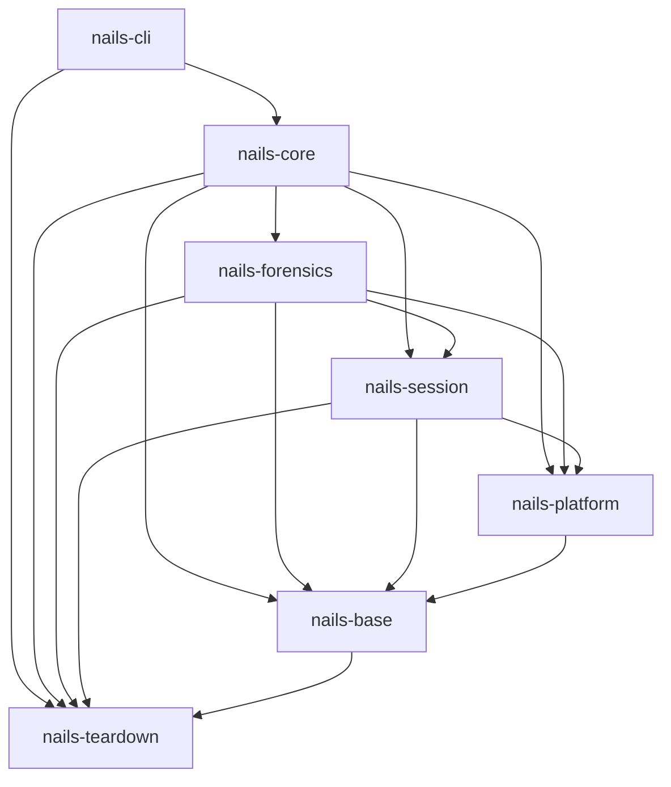

# Architecture overview

This is a map of how NAILS is put together: why the session takes the whole
root, the crates, the seam that keeps host-specific behaviour in one place, and
the runtime layers an activation runs through. It is an orientation document,
not a specification — the code is authoritative where it disagrees with this
page.

## Why one overlay over the whole root

The earlier live-overlay design overlaid the running decoy directory by
directory (`/etc`, `/home`, `/var` and others). The decoy kept running across
activation, so every process that existed before had to be found and restarted
or killed, journald had to be moved onto the overlay and the display manager
restarted. A writer the scan missed, such as a service in its own mount
namespace with binds onto the decoy filesystem, or a periodic writer that held
no file open during the scan, went on writing to the decoy, and nothing
reported it. No per-distribution heuristic closes that class of leak.

Overlays taken at boot (`overlayroot`, `systemd.volatile=overlay`, dracut's
overlay modules, Kicksecure's `grub-live`) need no such heuristics, but they
need a full reboot, keep the upper in RAM by default and leave an enabler on the
decoy: a package, a configuration file, a boot entry or a kernel command-line
flag. Such an enabler is evidence of a hidden mode in itself (see the
[invariant](threat-model.md#invariant)).

A soft-reboot into `/run/nextroot` (systemd 254 or newer) avoids both. NAILS
builds the overlay at runtime from the hidden volume, its upper stays on the
hidden volume, and nothing is installed on the decoy. systemd then stops all of
userspace, switches root into the overlay and starts a fresh userspace there:
every process of the hidden session starts inside the overlay, so there is
nothing to find, restart or kill, and whatever it writes through the decoy's
mounted filesystems lands in an upper on the hidden volume. The few writes that
go around the mount layer (a disk the session mounts itself, EFI variables) are
listed under the [residual channels](threat-model.md#residual-channels). The
kernel, its modules, the device-mapper mappings and `/run` survive the switch.
The way back is a second soft-reboot, again without firmware or bootloader.

The price:

- Both transitions log the user out, because the desktop itself runs inside the
  overlay. For the same reason an emergency ends at the decoy's login screen (or
  a freshly started desktop, where the display manager logs in automatically),
  or with the machine off; it cannot leave a desktop running.
- Kernel and service-manager state is not reset: the boot ID, the uptime, the
  kernel ring buffer, on systemd 256 and newer its soft-reboot counter, and the
  network state the hidden session set up (links, addresses, routes, VPN
  tunnels, a MAC address it changed) carry over until the machine powers off
  (see the [residual channels](threat-model.md#residual-channels)).
- The hidden systemd would mount every other filesystem in the decoy's fstab
  directly and read-write, so the
  [fstab policy](configuration.md#what-the-session-covers) decides for each one
  before the switch.
- The policy covers only the filesystems the decoy knows about. A disk the
  hidden session mounts itself, the decoy's own block device mounted again
  included, is a real disk outside every overlay. NAILS alerts on a read-write
  mount of one, and `session_mounts.read_only` makes the disks the session does
  not use read-only (see
  [disks mounted during the session](configuration.md#disks-mounted-during-the-session)).
- A next root whose init does not resolve can freeze PID 1, and a populated
  `/run/nextroot` would turn a later plain `reboot` into a soft-reboot into it.
  NAILS checks the init the way PID 1 will before every switch, and detaches a
  next root it did not finish.
- A host whose systemd is older than 254 cannot soft-reboot and is refused.

The `soft-reboot-mechanics` VM test pins this kernel and systemd behaviour
independently of the `nails` code, and the session tests run the same steps
through `nails`. What a virtual machine cannot show (graphics, Wi-Fi and the
time to the login screen on real hardware, TPM-sealed decoy roots, GRUB) is
listed under
[what has not been validated on hardware](operator-guide.md#what-has-not-been-validated-on-hardware).

## Crates

NAILS is a Cargo workspace with a deliberately thin binary, five library crates
split along the session's boundaries, and a small crate for the emergency hot
path and the soft-reboot transition. Each crate depends only on the crates
below it in this list. The edges between them, as the manifests declare them
and `nails-core/tests/crate_graph.rs` pins them:

`nails-cli` reaches `nails-teardown` directly because `main` runs the emergency
and the transition step before anything else is initialised.

- **`nails-cli`** parses arguments, renders human and JSON output, prompts, and
  turns results into the documented exit codes. It contains no activation logic:
  it builds a request, hands it to the library, and formats what comes back.
- **`nails-core`** ties the areas together: the manager (enter, leave,
  recover, reset-upper), the pre-flight registry and the checks that need
  several areas, and `status`. It re-exports every module of the crates below
  under its own name (`nails_core::config`, `nails_core::verify`, …), so the
  CLI talks to one library.
- **`nails-forensics`** looks for traces and never makes or removes them:
  `verify` (live and offline, the examiner's view, the drift scanners), the
  read-only raw-device and tree readers, the residue catalog and its check, and
  `rehearse`.
- **`nails-session`** is the configuration-aware half of the whole-root
  session: the entry, the fstab policy, the hidden NixOS build, the way back,
  the session's checks and the probes `status` uses, the persona, and the
  session's runtime units (the RAM copy reader, the backend watcher and the
  sleep guard).
- **`nails-platform`** holds everything host-specific: detection, the
  `Platform` backends, the NixOS configuration layer and its checks, the NixOS
  builder and the backend chain resolver.
- **`nails-base`** is the foundation every library crate reads: the error type,
  the `Filesystem` and process seams (with the host-command resolver),
  configuration, state, the artifact registry, the attach gate (with the
  judge of whether the hidden root lives on the decoy's own storage), logging,
  output, notifications and the pre-flight framework. It also holds the
  `/etc/fstab` and `/etc/crypttab` parsers, the walk of the block-device
  stack under a filesystem (read from sysfs) and the list of words that give
  hidden storage away in a name.
- **`nails-teardown`** holds everything the panic path and the soft-reboot
  transition need, with no configuration and no logging
  (`nails_teardown::whole_root`): the session plan on `/run`, the mount
  primitives and the pre-switch init check, the transition step, the `/run`
  snapshot and scrub, the kmsg cursor, the way back, the runtime units and
  masks, the kill of all userspace and the emergency hot path. It also holds the
  mountinfo parser, the rule for opening a file without updating its access
  time, and the cgroup, pidfd and shell kills. It depends on
  `rustix`, `libc`, `serde` and `serde_json` only, so `main` can run the emergency and the
  transition before clap, the configuration or tracing exist.

The logic lives in the libraries rather than in the binary, so the whole
threat-relevant surface can be tested without going through the binary or a
terminal, and each behaviour is defined once for every command. The crates
follow the session's areas so that one area cannot reach into another: besides
the graph test, `nails-forensics/tests/boundary.rs` keeps verification away
from the code that enters, leaves or tears down a session, and
`nails-teardown/tests/boundary.rs` fails when the panic path gains a
dependency, which keeps it small enough to review in one place.

## The platform seam

Every host-specific decision is made in one module, `platform` (in
`nails-platform`), so the rest of
the code never branches on "is this NixOS?" directly.

1. **Detection.** `platform::detect` reads `/etc/os-release`,
   `/run/current-system`, `/run/ostree-booted` and PID 1 once, producing a
   `HostProfile`.
2. **Selection.** A single function maps that profile to a backend implementing
   the `Platform` trait:
   - `NixOsPlatform` — the first-class backend, with a declarative config layer
     that builds the hidden system into the next root's store.
   - `FhsPlatform` — the backend for Debian-family hosts: Debian 13 and newer,
     Ubuntu 24.04 and newer, and provisionally derivatives whose `ID_LIKE`
     names `debian` or `ubuntu`. The hidden configuration is whatever the
     upper's `/etc` holds. (A Debian 12 host is refused by the support table;
     its systemd could not soft-reboot either.)
   - `UnsupportedPlatform` — refuses every other host with a typed error:
     ostree and image-based hosts, non-systemd init, Fedora, Arch and unknown
     distributions. For those hosts the refusal *is* the behaviour.
3. **Policy.** The trait collects the host-specific decisions: where host tools
   live (`host_command_dirs`) and which declarative build target activation and
   `check` use (`discover_build_target`). `verify` picks its read-only drift
   scanners from the detected platform kind.

The declarative part of a host is expressed through a separate `ConfigLayer`.
NixOS supplies one (`NixOsConfigLayer`), whose hidden system is built into the
next root's store; FHS hosts and any `--overlay-only` run have no layer, so the
build step is skipped and the session enters with the decoy's own system plus
the hidden `/etc`.

Adding a new distribution means adding a `Platform` backend (and, if it is
declarative, a `ConfigLayer`); nothing else in the codebase needs to learn about
it.

## Runtime layers

An activation moves through these layers; each names its modules and crates:

- **Configuration** (`config`, `nails-base`) loads strict TOML (`nails.toml`), layers CLI
  overrides on top, and derives the hidden-volume root from the binary location
  when it is not set. See the [configuration reference](configuration.md).
- **State machine** (`state`, `nails-base`) models the recorded state as a type-safe enum
  (`Inactive`, `Active`, `Degraded`) with only the legal transitions
  expressible, persisted to `state.json`. Because a soft-reboot keeps the boot
  ID, the live session (hidden root, entry under way, interrupted entry, plain
  decoy) is read from the mount table and the session plan
  (`session::probe`), not from the state file. Contradictory states cannot be
  represented, and a change to the variants is a change to the on-disk format.
- **Pre-flight** (the framework in `nails-base`, the registry and most checks
  in `nails-core`, `session::checks` in `nails-session`) runs a registry of
  trait-based checks — systemd version and the soft-reboot units, the decoy
  root, the fstab policy, backend readiness, overlay-filesystem capability,
  space, the amnesic-decoy guard, and more — before anything is mounted, and
  fails closed.
- **Entry** (`session::entry`, `session::policy`, `session::nixos`, in
  `nails-session`) snapshots `/run`, writes the session plan and the RAM copy of
  the binary to `/run/overlay-runtime` with a copy of libmount's `utab` and the
  mount table lines of the mounts it names, mounts the root overlay at
  `/run/nextroot`, builds and activates the hidden NixOS system there, applies
  the fstab policy, checks the init and installs the transition drop-in. Any
  failure undoes all of it, so a populated `/run/nextroot` is never left behind.
  How a path under the hidden root is resolved without following a planted link
  is described in `nails_base::filesystem::safe_path`; why the overlay covers
  the whole root and is entered with a soft-reboot is explained
  [above](#why-one-overlay-over-the-whole-root).
- **Transition** (`nails-teardown`, `whole_root::transition`) is the
  `ExecStart=` of `systemd-soft-reboot.service`, run by systemd from the RAM
  copy as the last userspace step before each switch. It acts only on an armed
  plan: entering, it repoints `/run/current-system` (NixOS), installs the
  session's runtime units and masks, narrows the `/run` snapshot to what the
  decoy's own shutdown left, drops the `utab` lines of the mounts the switch
  leaves behind and copies the decoy's name-server records; leaving, it repoints
  back, scrubs `/run`, puts those records back and, once the hidden units have
  stopped, gives the decoy's `utab` lines back to the mounts the way back
  restored and writes the kmsg cursor. libmount joins a `utab` line to the
  mount with the line's kernel mount ID, or, for a line without one, to the
  mount at the line's path with its source and root, and the kernel hands the
  IDs of the mounts a switch leaves behind to the next mounts it makes: a stale
  line would lend its options to an unrelated mount. An initrd's
  `x-initrd.mount` takes a mount out of systemd's shutdown order; when that
  happens while systemd mounts or unmounts it, PID 1 never runs the job that
  waited for that mount, and the switch or the power-off hangs. The decoy root
  and the filesystems the session carried come back as new mounts, so each of
  the decoy's lines that names an ID takes the ID of the mount now where its
  mount was at entry; a line that names no mount the way back restores is not
  given back. The transition writes `utab` as libmount does, through a new
  file renamed over the old one, under libmount's lock where its lock file
  exists. An unarmed populated `/run/nextroot` is detached instead.
- **Way back and emergency** (`nails-session`'s `session::leave`, `nails-teardown`'s
  `whole_root::ret` and `whole_root::emergency`) mount the decoy root at
  `/run/nextroot`, mark the backend for deferred removal and enqueue the
  soft-reboot; the emergency kills every hidden cgroup first. Emergency runs
  the hot path from `main` before clap, the configuration and tracing, so a
  failed hidden volume or an unreadable configuration cannot stop it.
- **Verification** (`verify`, `nails-forensics`) scans for known residue, live or offline against
  a decoy image.

## Testing without root

Filesystem and process effects are reached through the `Filesystem` and process
traits, with mock implementations used in tests. This lets almost the entire
library be unit-tested without root or a real mount. End-to-end behaviour that
genuinely needs a booted system — real soft-reboots, the hidden NixOS system,
the fstab policy, forensic residue — is covered by the NixOS VM tests under
`nix/e2e-tests` and the Debian/Ubuntu tier under `nix/distro-tests`. Between
the two, a rootless real-kernel tier (`nails_base::test_support::Rerun`, for
example `nails-core/tests/whole_root_kernel.rs`) runs the session's mount
primitives, transition step and cgroup kill on real mounts in a user and mount
namespace; see [testing-strategy.md](testing-strategy.md).
